# 🎨 BỘ THIẾT KẾ ICON VÀ UI HOMESCENE · 13 MÀN HÌNH

[Bản duyệt bố cục và icon dùng chung](Layout-v2/Bao-cao-bo-cuc.md)

**Dự án** Game 2D Roguelike Idle Capybara Adventure  
**Phạm vi** 13 màn hình và trạng thái từ brief HomeScene  
**Giai đoạn** Duyệt mockup tổng thể trước khi tách icon

## 1. Hướng đồ họa và thông số Figma

Nền dự án có tán cây tròn, viền xanh sẫm, mảng bóng rộng, bầu trời xanh nhạt, đường cát và đạo cụ gỗ. Icon dùng cùng ngôn ngữ hình khối để đứng cạnh cây, thùng và nhà mà vẫn dễ đọc trên màn hình nhỏ. Capybara Go! là tham chiếu thể loại phiêu lưu capybara vui nhộn. [BackGroundHome.png](../../Assets/Project/Sprite/AssetHome/BackGroundHome.png) · [Capybara Go! trên Google Play](https://play.google.com/store/apps/details?id=com.habby.capybara)

| Thành phần | Quy chuẩn đề xuất |
| --- | --- |
| Canvas | 768 × 1376 px theo brief, khung dọc xấp xỉ 9:16 |
| HUD và dock | HUD cao 110 px, padding 12 px. Dock cao 110 px với 5 tab |
| Icon HUD / dock / lối tắt | Khung thiết kế lần lượt 32 / 56 / 64 px trên canvas. Kiểm tra độ rõ ở bản xem thu nhỏ 50% |
| Nét và ánh sáng | Viền xanh sẫm `#244B59` cho vật liệu lạnh và nâu `#54382D` cho gỗ. Mỗi mặt chính dùng một mảng sáng và một mảng bóng |
| Nền và viền UI | Giấy da `#F8F0DC`, gỗ `#8D5B36`, đáy dock `#322318` |
| Nút và trạng thái | Vàng mật `#F5AF19` cho hành động chính, xanh `#2EA271` cho nâng cấp hoặc trang bị, đỏ san hô `#E1372D` cho khiêu chiến, tím `#805DB1` cho thời trang |
| Tab đang chọn | Nền vàng `#FFB428`, dấu lá và nhãn tab. Giữ cùng kích thước icon với tab thường |
| Định dạng | Markdown và mockup raster để duyệt. Kích thước và chữ trong ảnh là minh họa, thông số trong bảng là mục tiêu khi dựng component |

| Tab | Hình nhận diện |
| --- | --- |
| Shop | Mái bạt sọc trên quầy gỗ |
| Upgrade | Khiên gỗ có chevron hướng lên |
| Start | Mái nhà xanh, tab giữa |
| Phó bản | Tháp đá leo dây thường xuân |
| Thành tựu | Cúp vàng có vòng lá |

## 2. Bộ ảnh 13 màn hình

- [01 · Start · Trang chủ](#scene-01)
- [02 · Start · Popup gói tân thủ](#scene-02)
- [03 · Shop · Gói nạp và tiền tệ](#scene-03)
- [04 · Shop · Gacha](#scene-04)
- [05 · Upgrade · Nhân vật](#scene-05)
- [06 · Upgrade · Trang phục](#scene-06)
- [07 · Upgrade · Mua pet](#scene-07)
- [08 · Upgrade · Vườn thú và đổi slot](#scene-08)
- [09 · Upgrade · Skill Stone](#scene-09)
- [10 · Phó bản · Tháp Ngũ Hành](#scene-10)
- [11 · Phó bản · Đấu trường PvP / PvE](#scene-11)
- [12 · Thành tựu · Nhiệm vụ C–B–A–S](#scene-12)
- [13 · Thành tựu · Xếp hạng vùng](#scene-13)

### Scene 01 · Start · Trang chủ

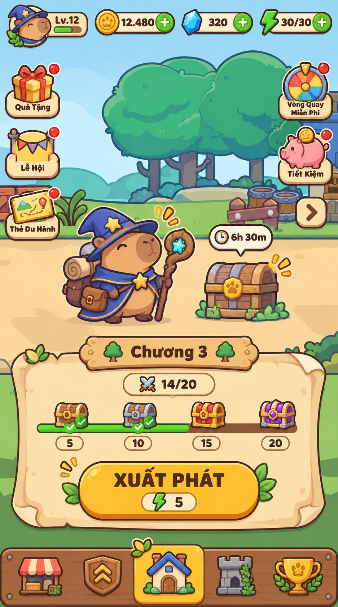

**Bố cục** Hai cột lối tắt ôm khung cảnh làng. Capybara phù thủy và rương AFK đứng trên đường cát. Tiến trình chương và nút Xuất phát nằm sát dock.

**Icon đề xuất** Hộp quà, cờ lễ hội tam giác, thẻ hành trình có dấu sáp, bánh xe chia múi, heo đất, chevron thu gọn và rương AFK. Rương mốc dùng chung dáng với rương AFK nhưng bỏ đồng hồ.

**Duyệt** ☐ Đồng ý ☐ Cần chỉnh

### Scene 02 · Start · Popup gói tân thủ

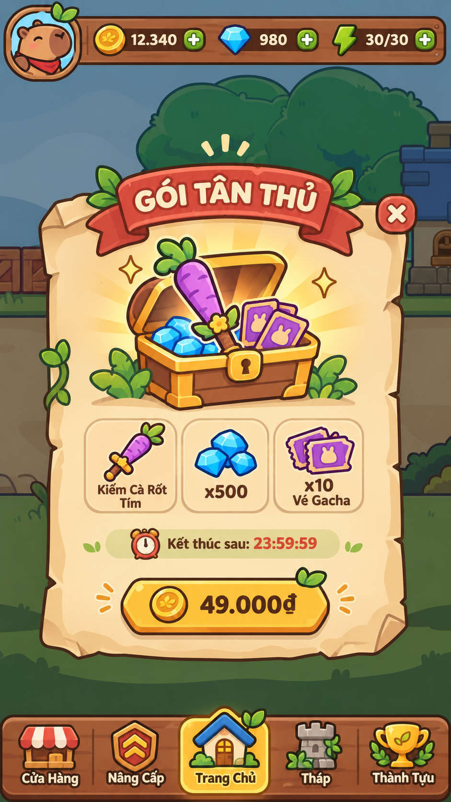

**Bố cục** Phủ mờ Trang chủ, mở giấy da giữa màn với nút đóng, rương thưởng, bộ vật phẩm, giờ và nút hành động.

**Icon đề xuất** Rương mở lộ ánh vàng, kiếm cà rốt tím, cụm đá lam, vé răng cưa, đồng hồ và dấu đóng. Giữ hình khối phần thưởng riêng để đọc được trên cùng một hàng.

**Duyệt** ☐ Đồng ý ☐ Cần chỉnh

### Scene 03 · Shop · Gói nạp và tiền tệ

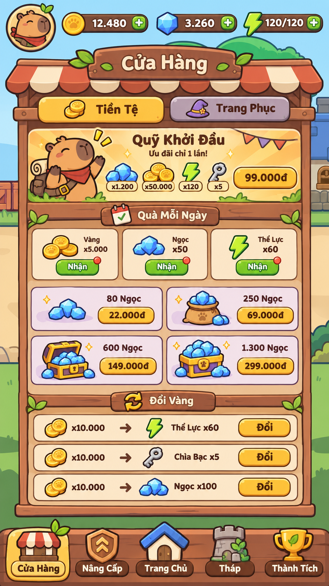

**Bố cục** Banner quỹ tân thủ, quà ngày, lưới gói kim cương và hàng đổi vàng.

**Icon đề xuất** Đá lam một viên, đá lam theo cụm, tia thể lực xanh, khóa bạc và chồng xu vàng. Tăng số khối hoặc đổi vật chứa để phân biệt gói lớn.

**Duyệt** ☐ Đồng ý ☐ Cần chỉnh

### Scene 04 · Shop · Gacha

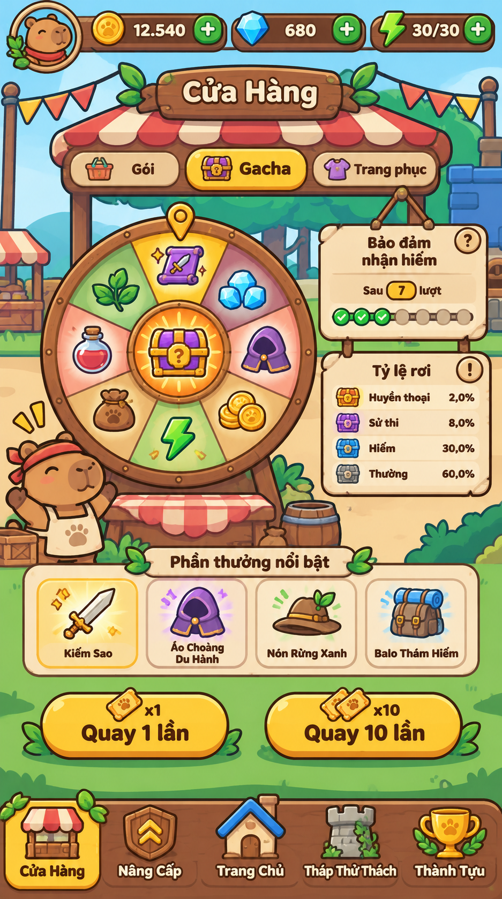

**Bố cục** Vòng quay và rương bí ẩn chiếm trọng tâm. Thanh bảo hiểm, nút tỷ lệ, hai nút quay và hàng thưởng nằm bên dưới.

**Icon đề xuất** Vòng quay có kim chỉ lớn, rương có ổ khóa hình sao, nút thông tin chữ i và viền phẩm cấp cho ô thưởng.

**Duyệt** ☐ Đồng ý ☐ Cần chỉnh

### Scene 05 · Upgrade · Nhân vật

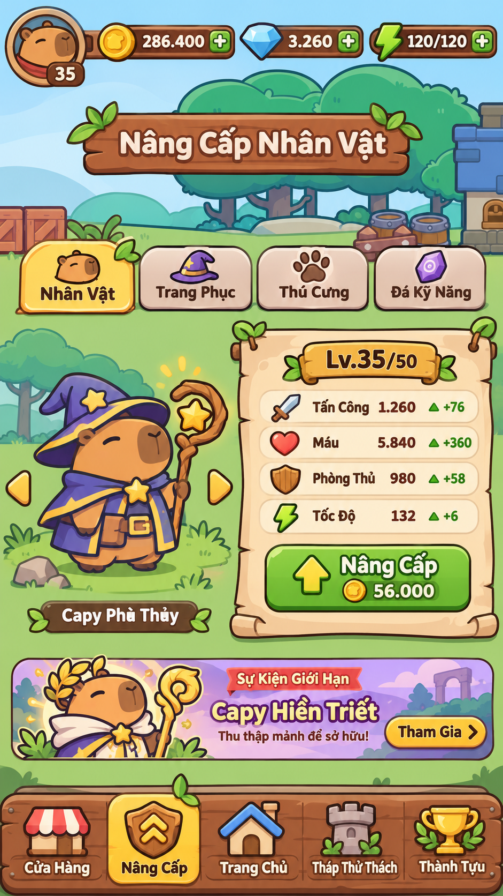

**Bố cục** Capybara ở giữa nút chuyển trái phải. Thẻ chỉ số, nút nâng cấp và banner nhân vật sự kiện xếp theo chiều dọc.

**Icon đề xuất** Kiếm Công, tim Máu, khiên Thủ, tia Bạo màu hổ phách. Tia thể lực trên HUD luôn xanh, tia Bạo có thêm dấu lóe cạnh.

**Duyệt** ☐ Đồng ý ☐ Cần chỉnh

### Scene 06 · Upgrade · Trang phục

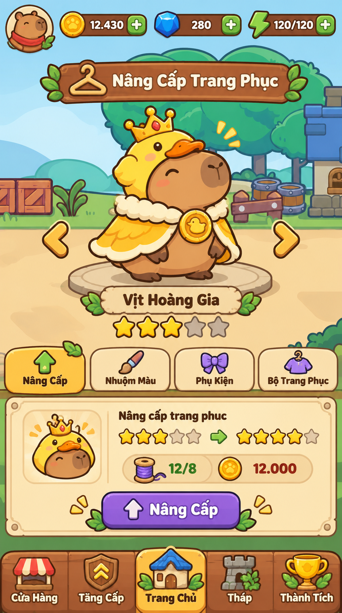

**Bố cục** Phòng thử đồ với set Vịt Vàng trên nhân vật, hàng sao thời trang, chi phí chỉ và vàng, nút nâng sao tím.

**Icon đề xuất** Mũ vịt làm thumbnail bộ đồ, cuộn chỉ có đầu dây cong, sao đầy và sao rỗng. Dùng lại cặp mũi tên của Nhân vật.

**Duyệt** ☐ Đồng ý ☐ Cần chỉnh

### Scene 07 · Upgrade · Mua pet

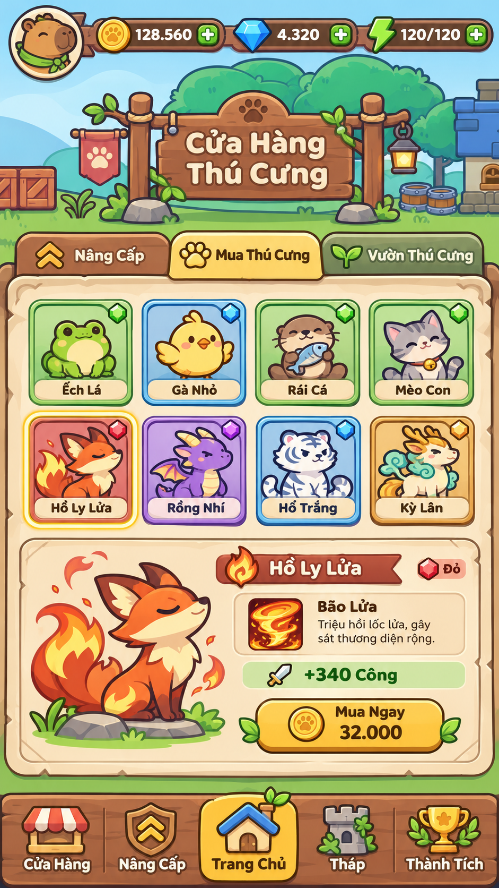

**Bố cục** Lưới tám pet theo phẩm cấp. Cáo Lửa được chọn và hiện trong thẻ chỉ số, kỹ năng và nút mua.

**Icon đề xuất** Cóc Cỏ, Gà Con, Rái Cá, Mèo Con, Cáo Lửa, Rồng Con, Bạch Hổ và Kỳ Lân. Viền phẩm cấp xanh lá, lam, tím, vàng, đỏ đi kèm ký hiệu cấp khi triển khai.

**Duyệt** ☐ Đồng ý ☐ Cần chỉnh

### Scene 08 · Upgrade · Vườn thú và đổi slot

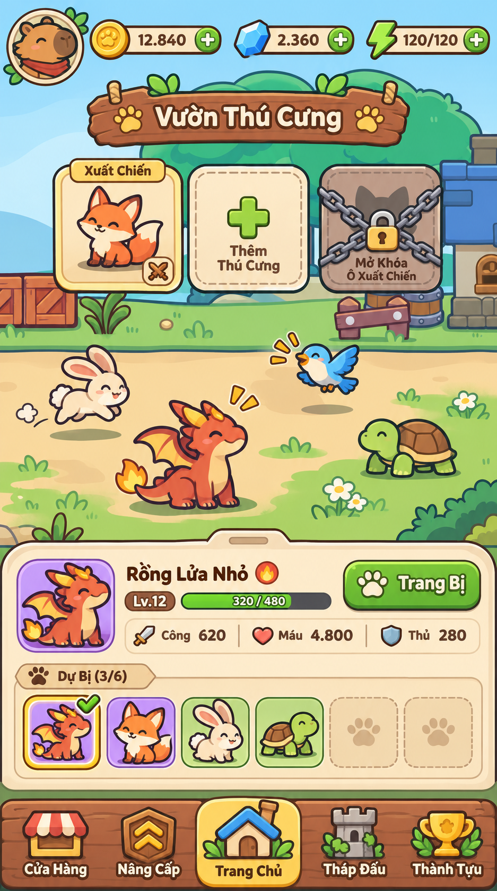

**Bố cục** Ba slot trên cùng, bãi cỏ ở giữa và bảng đổi pet trượt từ dưới. Hỏa Long đang được chọn.

**Icon đề xuất** Ba hình trạng thái gồm chân dung Cáo Lửa, dấu cộng trên ô mở và khóa có xích trên ô khóa. Dùng lại chân dung pet từ lưới.

**Duyệt** ☐ Đồng ý ☐ Cần chỉnh

### Scene 09 · Upgrade · Skill Stone

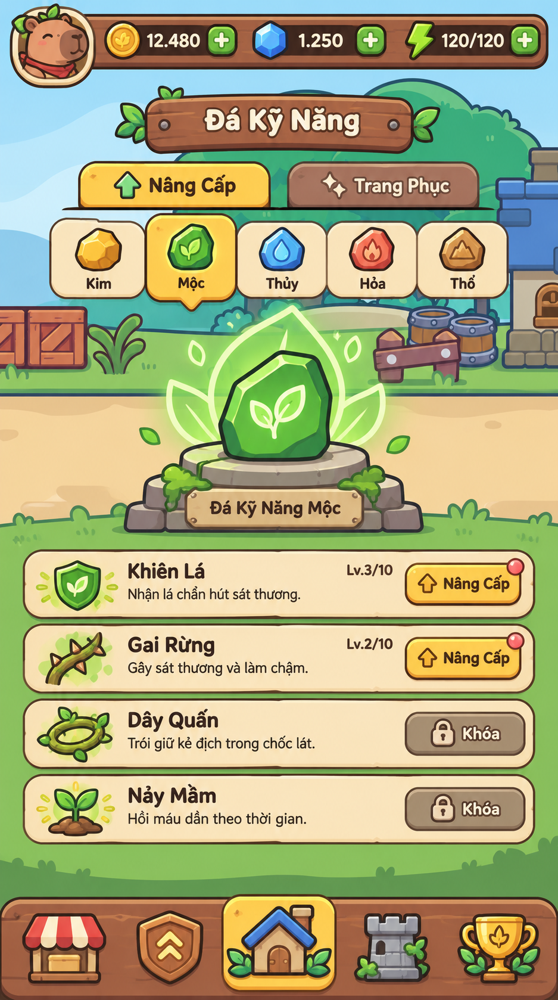

**Bố cục** Năm bộ lọc hệ, đá Mộc trên bệ, hiệu ứng lá chắn và danh sách bốn kỹ năng.

**Icon đề xuất** Kim mặt đa giác vàng, Mộc lá xanh, Thủy giọt lam, Hỏa ngọn lửa san hô, Thổ khối đá đất. Lá chắn, gai, dây leo, chồi non là bốn hình riêng của bộ Mộc.

**Duyệt** ☐ Đồng ý ☐ Cần chỉnh

### Scene 10 · Phó bản · Tháp Ngũ Hành

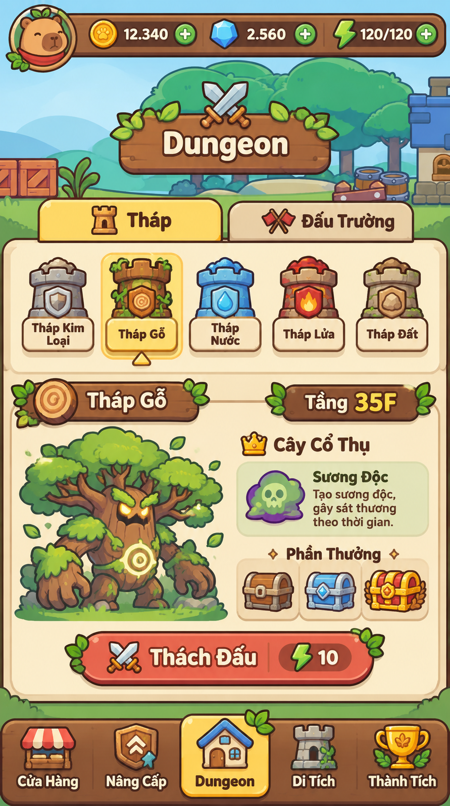

**Bố cục** Năm tháp theo nguyên tố, xem trước Cổ Thụ Tinh ở tầng 35, hiệu ứng khí độc, ba mốc quà và nút khiêu chiến.

**Icon đề xuất** Mỗi tháp có mái và vật liệu khác nhau, kèm huy hiệu nguyên tố dùng chung với Skill Stone. Khí độc là mây có xoáy và tông tím xám.

**Duyệt** ☐ Đồng ý ☐ Cần chỉnh

### Scene 11 · Phó bản · Đấu trường PvP / PvE

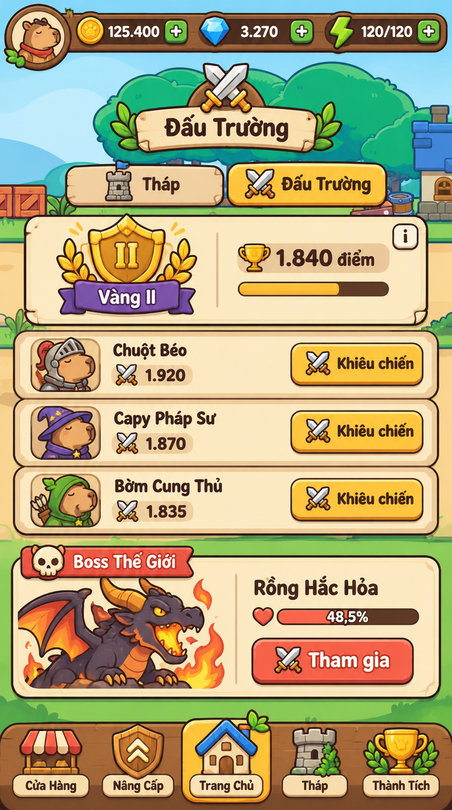

**Bố cục** Huy hiệu Vàng II, ba hàng đối thủ và khối Boss Thế Giới có thanh máu.

**Icon đề xuất** Khiên hạng có hai vạch, chân dung đối thủ hình tròn và Hắc Hỏa Long có silhouette đầu rồng với lửa sẫm. Dấu kiếm giao nhau dành cho khiêu chiến.

**Duyệt** ☐ Đồng ý ☐ Cần chỉnh

### Scene 12 · Thành tựu · Nhiệm vụ C–B–A–S

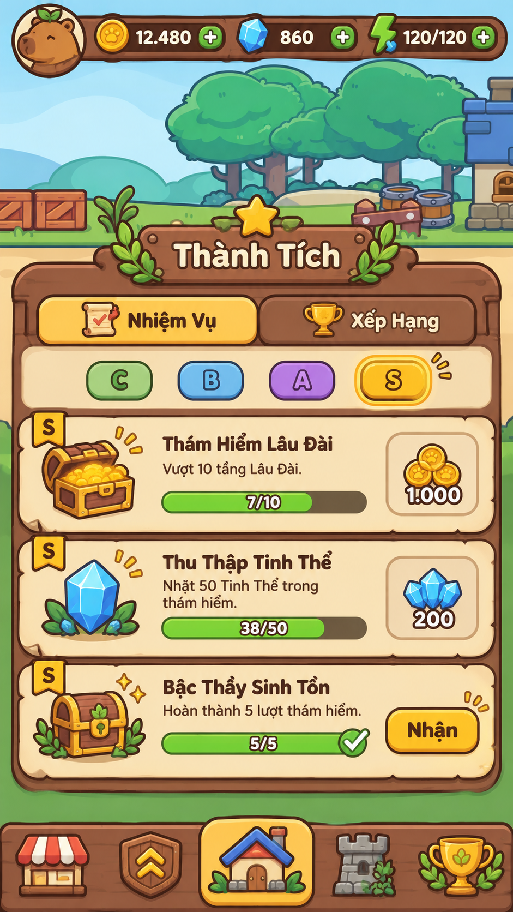

**Bố cục** Bộ lọc cấp, thẻ mục tiêu giấy da, tiến độ, thưởng và nút Nhận quà.

**Icon đề xuất** Dấu hạng dùng chữ C, B, A, S bên trong huy hiệu. Thẻ hoàn thành có dấu kiểm bên cạnh thanh tiến độ. Rương và đá lam tái sử dụng từ Home và Shop.

**Duyệt** ☐ Đồng ý ☐ Cần chỉnh

### Scene 13 · Thành tựu · Xếp hạng vùng

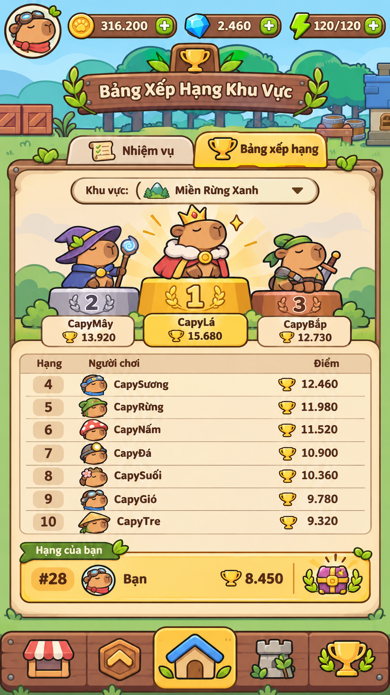

**Bố cục** Bộ chọn vùng, bục top 3, hàng hạng 4–10 và vị trí người chơi ghim đáy.

**Icon đề xuất** Cúp vòng lá, huy chương vàng bạc đồng có số hạng, chevron bộ chọn vùng và rương mùa giải.

**Duyệt** ☐ Đồng ý ☐ Cần chỉnh

## 3. Các điểm cần chốt trước khi tách icon

- Kiểm tra năm biểu tượng dock khi nhìn ảnh ở 50% và chốt hình dáng từng tab.
- Chốt màu, độ dày viền và mức đổ bóng khi icon nằm trên nền làng của Scene 01.
- Chốt các biểu tượng tái sử dụng gồm xu, đá, thể lực, khóa, rương, điều hướng và năm hệ. Dùng các ảnh Scene 01, 05 và 09 làm mốc so sánh.
- Dựa vào brief gốc để duyệt chính tả, giá, số lượng và trạng thái triển khai. Các chi tiết chữ hoặc số có thể sai lệch trong ảnh concept.

## 4. Nội dung mẫu để đối chiếu với brief

| Scene | Nội dung cần giữ khi dựng UI |
| --- | --- |
| 01 | Gói đầu +800%, lễ hội 05d 12h, thẻ hành trình, vòng quay miễn phí, heo đất 75%, AFK 6h 30m, Hồi 4 · Rừng Tiêu Dao · 14/20, bốn mốc 25/50/75/100%, Xuất phát tốn 5 thể lực |
| 02 | Gói tân thủ +800%, kiếm cà rốt tím, 1.000 kim cương, 20 vé, đếm ngược, giá mẫu 24.000 VNĐ |
| 03 | Quỹ tân thủ, quà ngày 50 kim cương / 15 thể lực / 1 khóa bạc, bốn gói kim cương 100 / 550 / 1.200 / 3.000, ba mốc đổi vàng 50K / 250K / 1M |
| 04 | Bảo hiểm còn 7 lượt, nút Xem tỷ lệ, quay 1 lần 300 kim cương, quay 10 lần 2.700, bốn ô phần thưởng |
| 05 | Đang xuất trận 1/1, Lv.35/50, Công / Máu / Thủ / Bạo, nâng cấp lên 36, nhân vật sự kiện 2.000 kim cương |
| 06 | Vịt Vàng, 3/5 sao, chỉ ma thuật và vàng |
| 07 | Tám pet, năm phẩm cấp, Cáo Lửa Công +340, Bão Lửa, giá mẫu 500 kim cương |
| 08 | Slot 1 Cáo Lửa, slot 2 dấu cộng, slot 3 mở ở cấp 35, Hỏa Long ở trạng thái có thể trang bị |
| 09 | Lá Chắn Mộc Linh đang dùng, Gai Độc Rừng Già giá 500 kim cương, Dây Leo Quấn Chân khóa cấp 30, Vạn Vật Tái Sinh khóa cấp 45 |
| 10 | Tháp Mộc 35F, Cổ Thụ Tinh, khí độc, ba hòm quà, chi phí 10 thể lực |
| 11 | Vàng II và 1.840 điểm, ba đối thủ, Hắc Hỏa Long Tổ với 48,5% máu |
| 12 | Bộ lọc C/B/A/S, S đang chọn, mục tiêu, tiến độ, phần thưởng và Nhận quà |
| 13 | Server 01 · Miền Bắc, bục Bạc/Vàng/Đồng, Top 4–10, #28 CapyDoi với 8.450 điểm |

## 5. Prompt tạo ảnh

Công cụ tạo ảnh là ImageGen tích hợp. Ảnh tham chiếu cho cả 13 lượt là `BackGroundHome.png`. Mỗi lượt ghép prompt chung với yêu cầu bố cục và icon riêng của màn hình tương ứng trong mục 2.

> Generate one full edge-to-edge mobile game UI screenshot mockup, portrait approximately 9:16, no phone bezel or external margins. Original Vietnamese cozy 2D roguelike capybara project. Use the supplied BackGroundHome.png as art direction reference: blue sky, turquoise distant hills, emerald rounded tree canopies, yellow sandy path, pale green grass, rust brown timber, deep teal or warm brown outlines, big flat readable silhouettes, two-tone cel shadows, restrained highlights. Use the village backdrop for Start and adapt its palette for the other screens. Draw original chunky pictograms. Use a capybara avatar, gold, blue gem and green energy counters on the HUD. Use a fixed timber dock with striped shop awning, upward chevron on wooden shield, centered blue-roof home, ivy stone tower, and gold leaf trophy. Highlight the current tab with a honey backplate and leaf accent. Use cream parchment, honey primary actions, green positive actions, coral challenge actions, violet costume actions. Prioritize graphic clarity and short Vietnamese labels.

Khi dựng từ mockup, áp dụng trạng thái dock theo nhóm màn hình. Scene 01–02 chọn Start, 03–04 chọn Shop, 05–09 chọn Upgrade, 10–11 chọn Phó bản, 12–13 chọn Thành tựu. Một số ảnh hiện vẫn làm sáng biểu tượng nhà giữa dock.

