# HomeScene · Duyệt bố cục 13 màn hình

[Báo cáo bộ icon và hình ảnh đã duyệt](../Bao-cao-HomeScene.md)

[Mở bản duyệt 13 màn với HUD và dock dùng chung](Duyet-icon.html). Cùng một ảnh Start cung cấp avatar, xu, kim cương, thể lực và năm hình biểu tượng dock. Nền vàng thể hiện tab đang chọn. Popup tân thủ làm tối HUD và ẩn dock theo ảnh mẫu. Các PNG trong bảng được xuất từ cùng bản HTML. Phần nội dung trong thẻ, hình minh họa và một số icon riêng vẫn đến từ từng mockup, nên có thể còn khác về nét hoặc chi tiết.

Bộ 13 ảnh `scene01–scene13` trong `home_scene_ui_ux_design.md` là mẫu bố cục. Bản trước là mẫu nét, chất liệu và icon. Mục tiêu của lượt sửa là đưa các khối về đúng vị trí, thứ tự, số hàng và cột như ảnh gốc.

Năm huy hiệu nguyên tố dùng cùng hình trên bộ lọc Skill Stone và thẻ Tháp Ngũ Hành. Bản duyệt cũng dùng lại hình Cáo Lửa từ lưới mua pet ở slot xuất trận và dùng hình xu, kim cương từ HUD trong popup tân thủ. Kích thước được điều chỉnh theo diện tích từng ô.

## Scene 01 · Trang chủ

Đưa lối tắt lên hai mép trên, giữ capybara và rương trên đường cát. Đặt thẻ tiến trình giữa màn, hai nút Nhận nhanh và Xuất phát cùng hàng, chừa khoảng cỏ lớn trước dock.

| Ảnh bố cục gốc | Mockup sửa | 
| --- | --- |
| 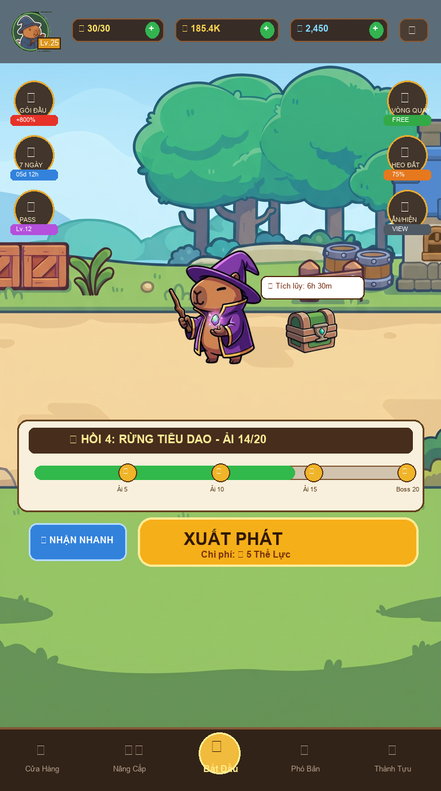 | 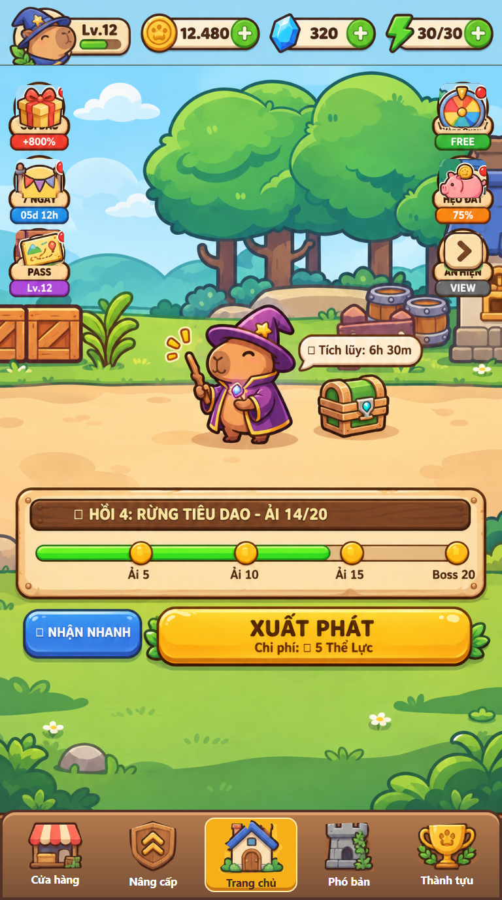 |

**Duyệt bố cục** ☐ Đồng ý ☐ Cần chỉnh

## Scene 02 · Popup tân thủ

Modal phủ nền Trang chủ làm tối. Ruy-băng và nút đóng ở đầu, rương ở giữa, bốn ô thưởng 2 × 2, viên thời gian và nút mua xanh theo thứ tự từ trên xuống.

| Ảnh bố cục gốc | Mockup sửa | 
| --- | --- |
| 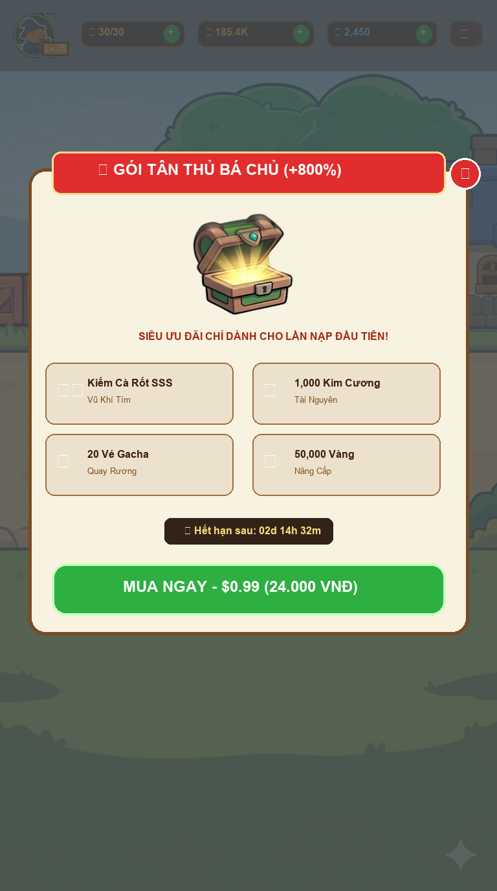 | 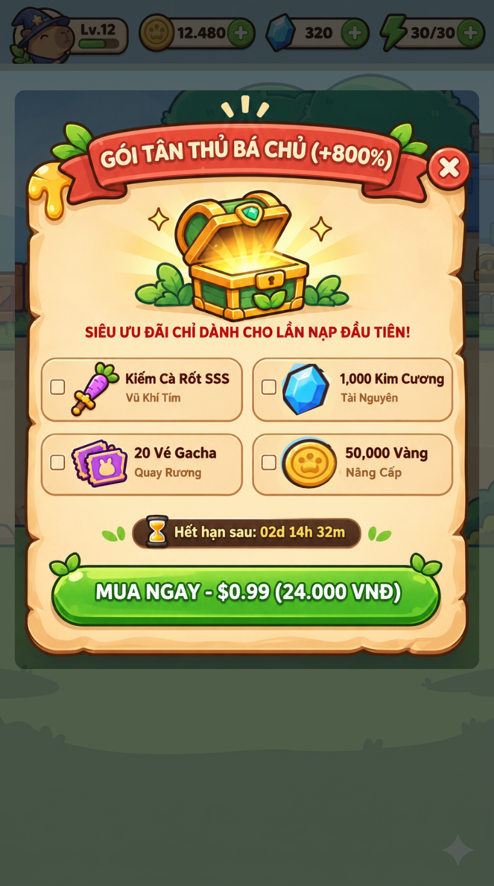 |

**Duyệt bố cục** ☐ Đồng ý ☐ Cần chỉnh

## Scene 03 · Gói nạp và tiền tệ

Giữ hai tab. Banner đỏ nằm trên một hàng ba thẻ quà, lưới nạp 2 × 2 và một hàng ba thẻ đổi vàng. Chừa nền cỏ phía dưới.

| Ảnh bố cục gốc | Mockup sửa | 
| --- | --- |
| 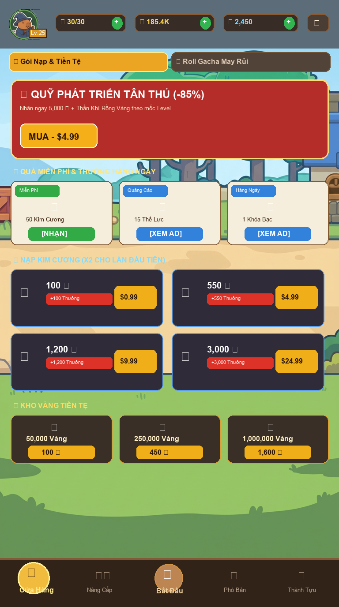 | 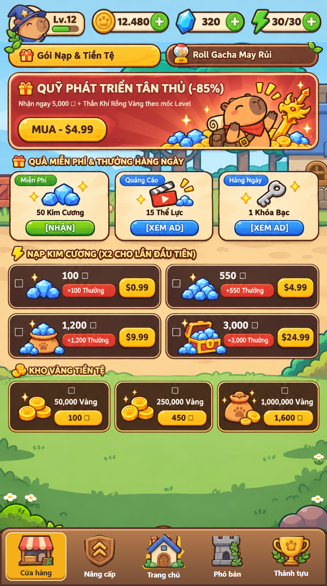 |

**Duyệt bố cục** ☐ Đồng ý ☐ Cần chỉnh

## Scene 04 · Gacha

Đưa tỷ lệ và thanh bảo hiểm về dưới vòng quay. Hai nút quay nằm ngang trong cùng panel. Dùng lưới thưởng 2 × 2 trong panel riêng.

| Ảnh bố cục gốc | Mockup sửa | 
| --- | --- |
| 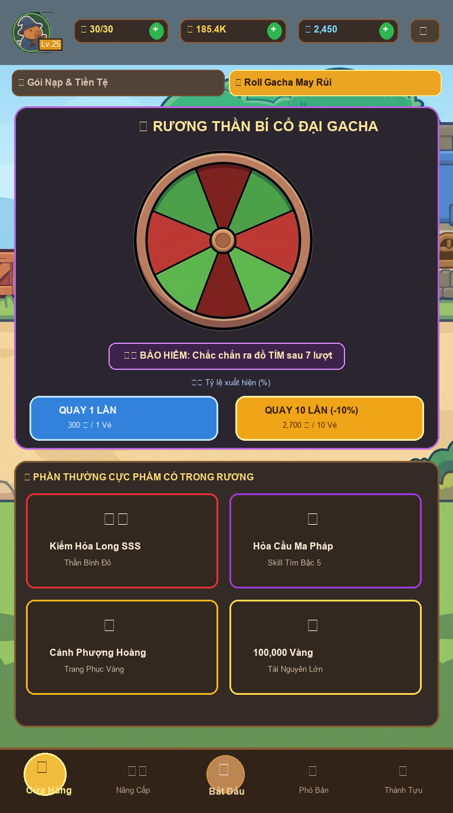 | 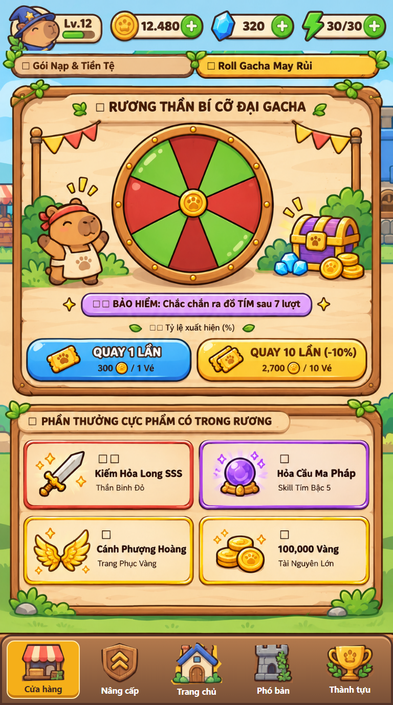 |

**Duyệt bố cục** ☐ Đồng ý ☐ Cần chỉnh

## Scene 05 · Nhân vật

Giữ bốn sub-tab. Tách sân khấu xanh đậm toàn chiều ngang khỏi thẻ chỉ số bên dưới. Banner nhân vật sự kiện nằm ở cuối.

| Ảnh bố cục gốc | Mockup sửa | 
| --- | --- |
| 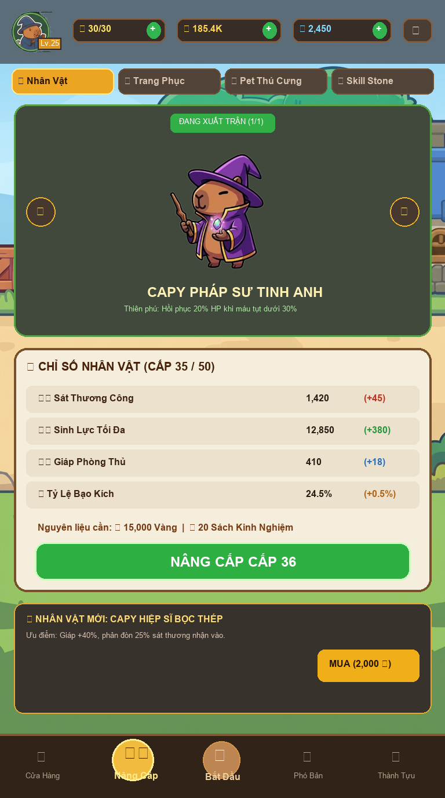 | 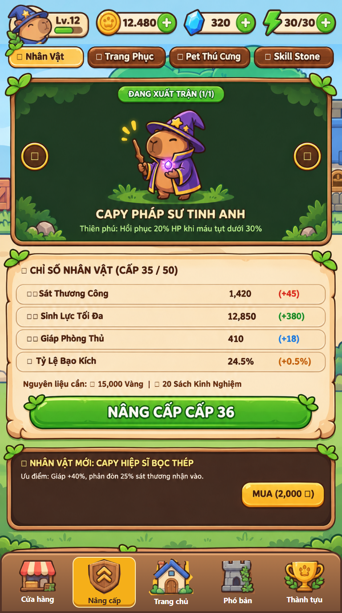 |

**Duyệt bố cục** ☐ Đồng ý ☐ Cần chỉnh

## Scene 06 · Trang phục

Sân khấu thử đồ tím đậm với mũi tên hai bên. Thẻ nâng sao phủ toàn chiều ngang ngay bên dưới, sau đó là dải mua bộ đồ khác.

| Ảnh bố cục gốc | Mockup sửa | 
| --- | --- |
| 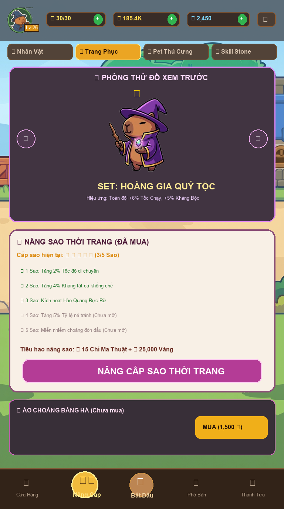 | 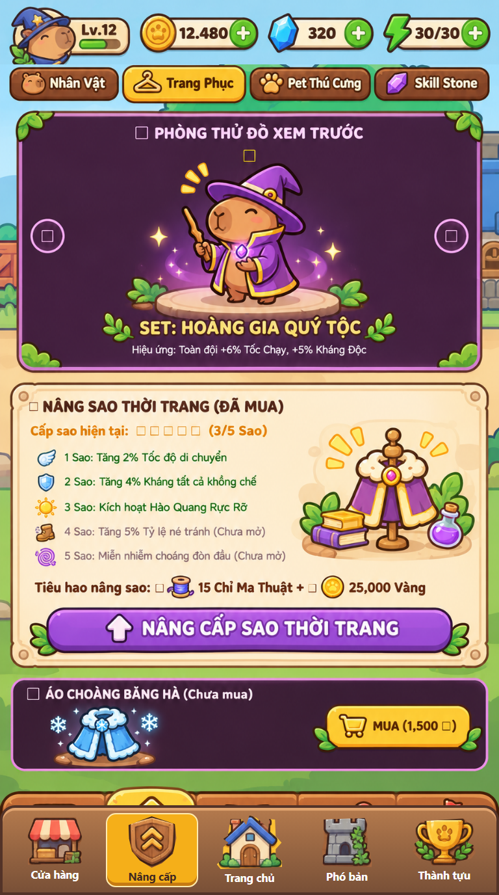 |

**Duyệt bố cục** ☐ Đồng ý ☐ Cần chỉnh

## Scene 07 · Mua pet

Giữ bốn sub-tab và hai nút Pet. Lưới 4 × 2 nằm trong panel tối. Chi tiết Cáo Lửa đặt ảnh trái, mô tả phải, nút mua phủ ngang cuối thẻ.

| Ảnh bố cục gốc | Mockup sửa | 
| --- | --- |
| 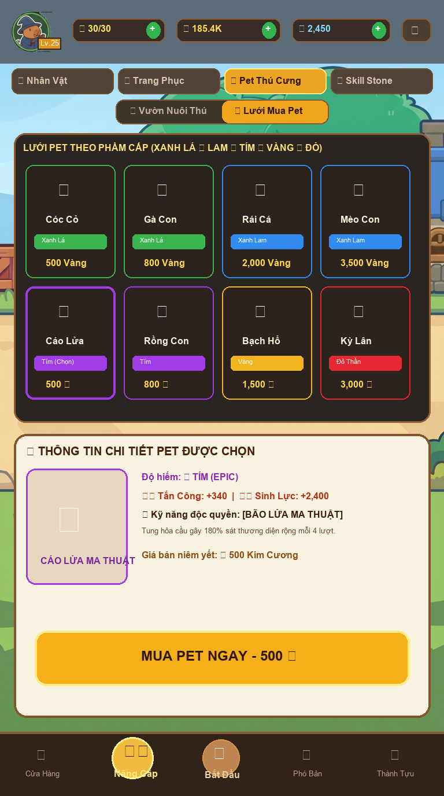 | 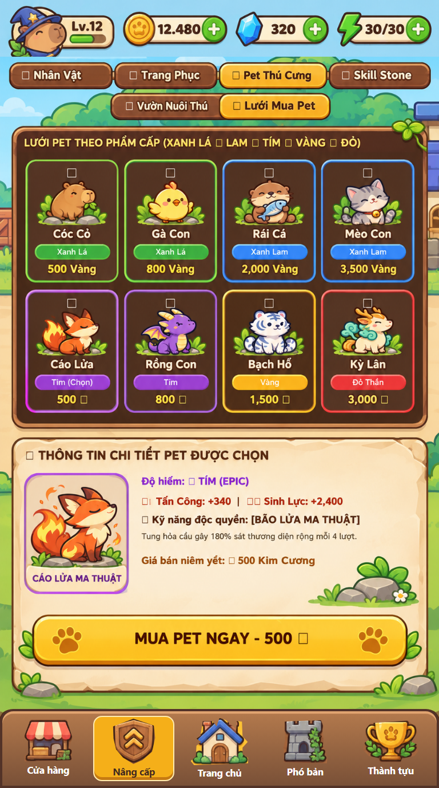 |

**Duyệt bố cục** ☐ Đồng ý ☐ Cần chỉnh

## Scene 08 · Vườn thú và đổi slot

Thanh slot tối nằm trên bãi cỏ riêng. Bảng đổi pet ở dưới bãi cỏ, gồm hàng pet đã chọn và ba hàng pet dự bị đầy chiều ngang.

| Ảnh bố cục gốc | Mockup sửa | 
| --- | --- |
| 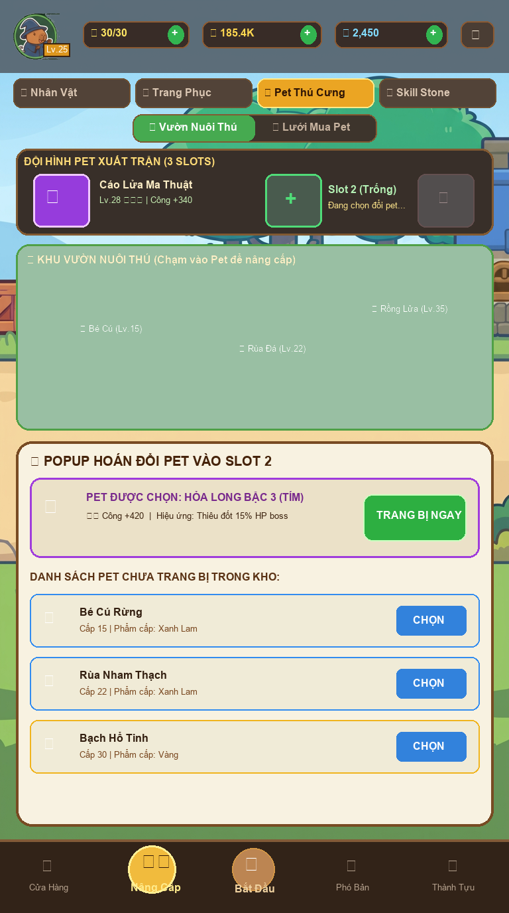 | 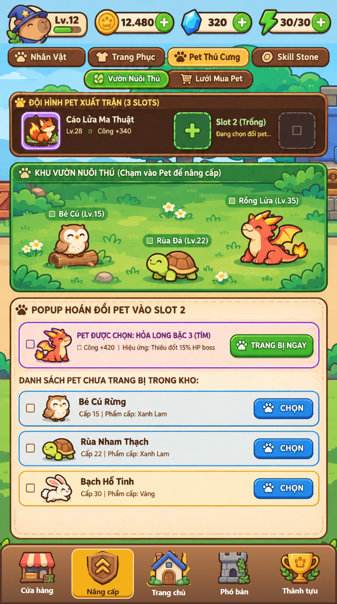 |

**Duyệt bố cục** ☐ Đồng ý ☐ Cần chỉnh

## Scene 09 · Skill Stone

Giữ bốn sub-tab và hàng lọc năm hệ. Đá Mộc ở bên trái thẻ xanh, mô tả bên phải. Bốn kỹ năng nằm trên bốn hàng riêng bên dưới.

| Ảnh bố cục gốc | Mockup sửa | 
| --- | --- |
| 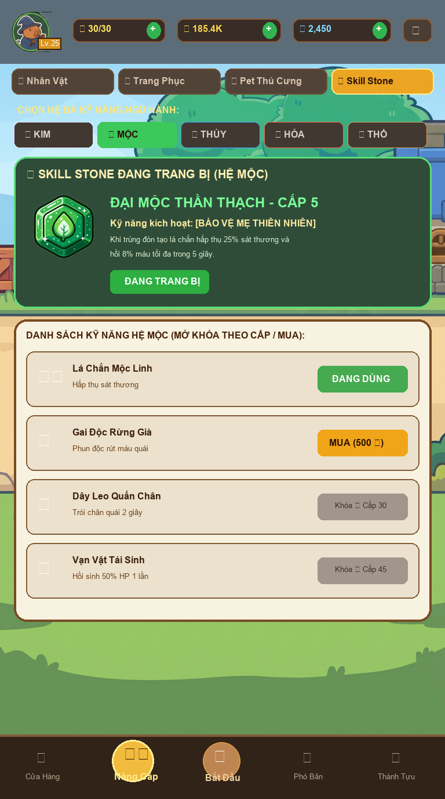 | 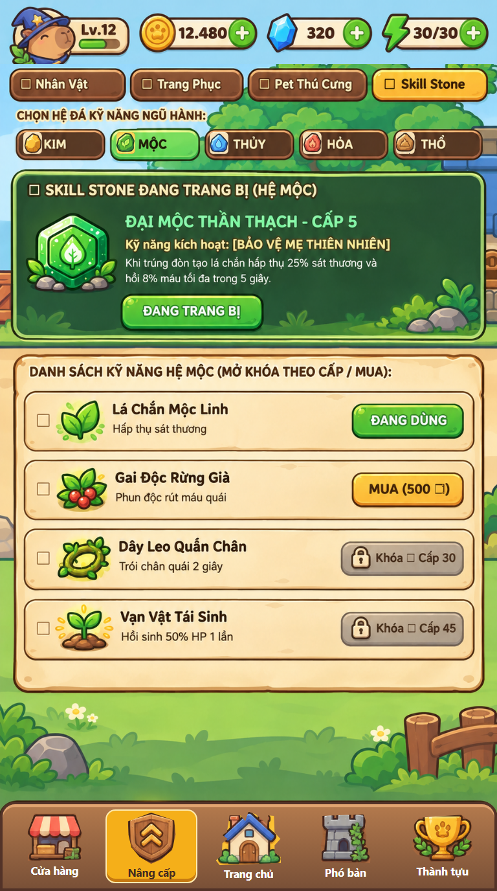 |

**Duyệt bố cục** ☐ Đồng ý ☐ Cần chỉnh

## Scene 10 · Tháp Ngũ Hành

Đặt năm tháp trên cùng một hàng. Panel tầng 35 có tiêu đề xanh, boss bên trái, điều kiện và ba ô quà bên phải. Nút đỏ nằm cuối panel, cách dock một vùng cỏ.

| Ảnh bố cục gốc | Mockup sửa | 
| --- | --- |
| 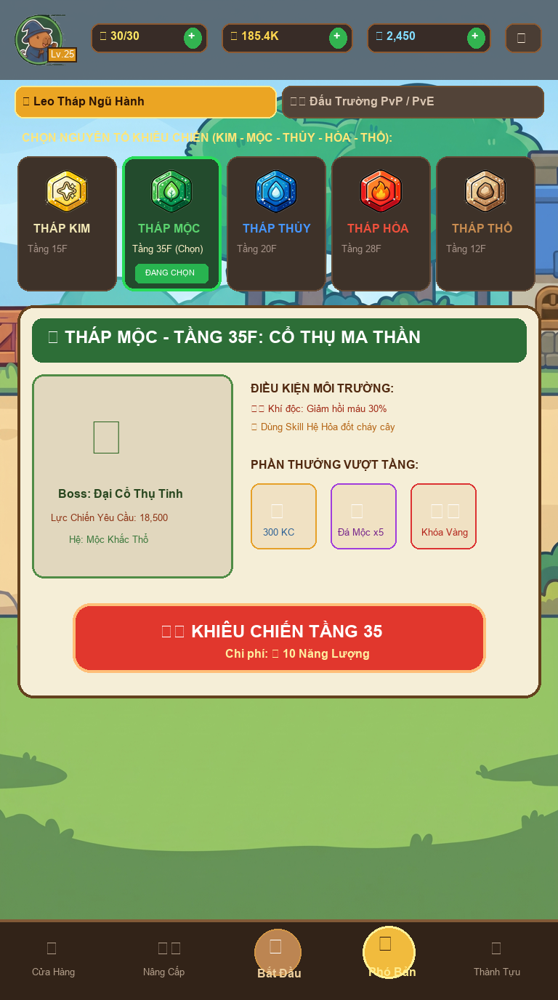 | 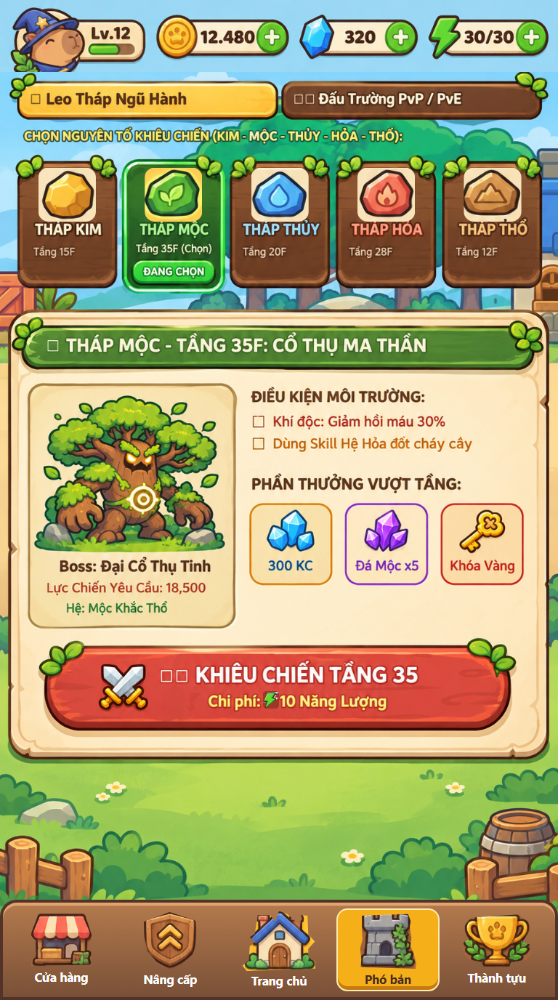 |

**Duyệt bố cục** ☐ Đồng ý ☐ Cần chỉnh

## Scene 11 · Đấu trường

Banner hạng Vàng ở trên ba hàng đối thủ. Nút thách đấu xanh, vàng, đỏ ở mép phải. Khối boss nền tối, thanh máu và nút đỏ bên dưới.

| Ảnh bố cục gốc | Mockup sửa | 
| --- | --- |
| 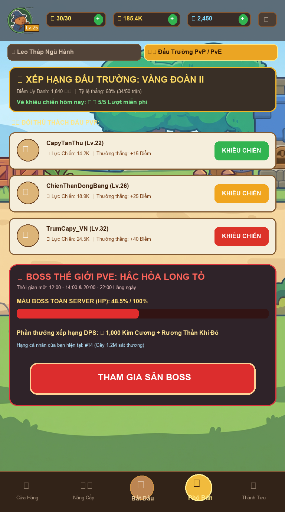 | 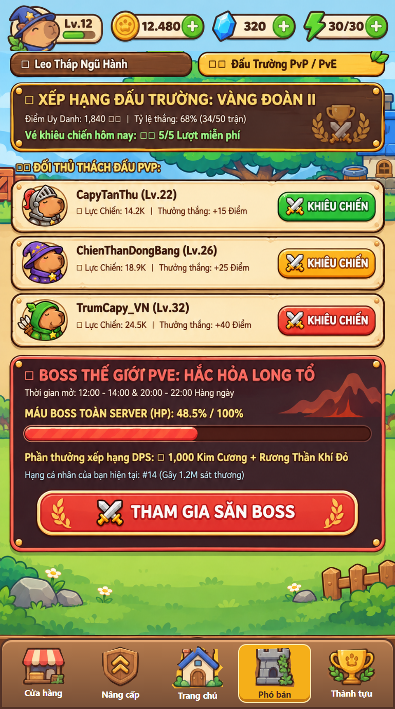 |

**Duyệt bố cục** ☐ Đồng ý ☐ Cần chỉnh

## Scene 12 · Nhiệm vụ

Đặt hai tab, bốn bộ lọc cấp và dải thông tin tối ở đầu. Bên dưới có năm thẻ nhiệm vụ xếp dọc với tiến độ trái, nút phải.

| Ảnh bố cục gốc | Mockup sửa | 
| --- | --- |
| 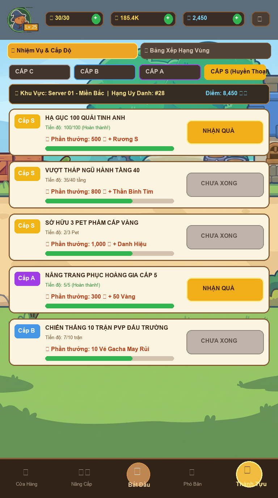 | 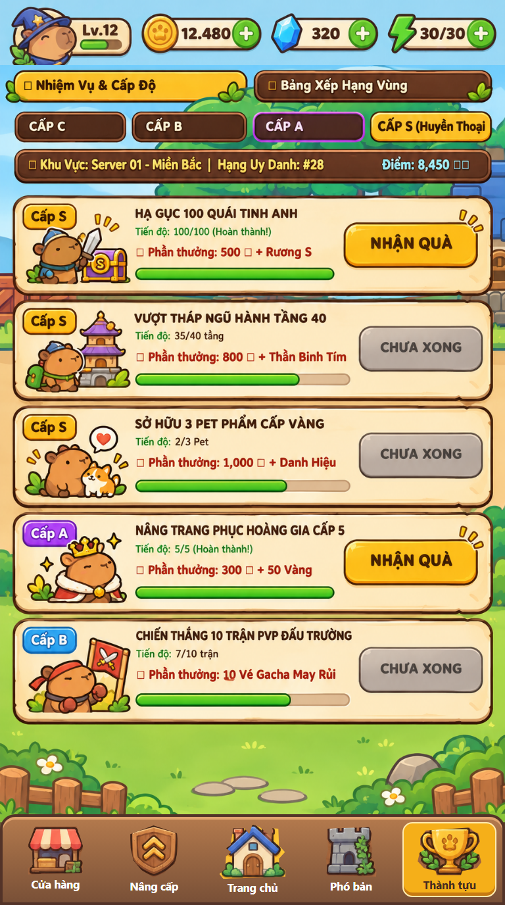 |

**Duyệt bố cục** ☐ Đồng ý ☐ Cần chỉnh

## Scene 13 · Xếp hạng vùng

Đặt bộ chọn vùng trên bục ba thẻ Bạc–Vàng–Đồng. Hiển thị bốn hàng #4–7 như ảnh mẫu, rồi thanh ghim #28 và nút thưởng xanh. Chừa khoảng cỏ sau thanh ghim.

| Ảnh bố cục gốc | Mockup sửa | 
| --- | --- |
| 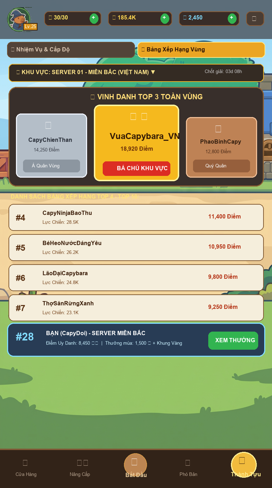 | 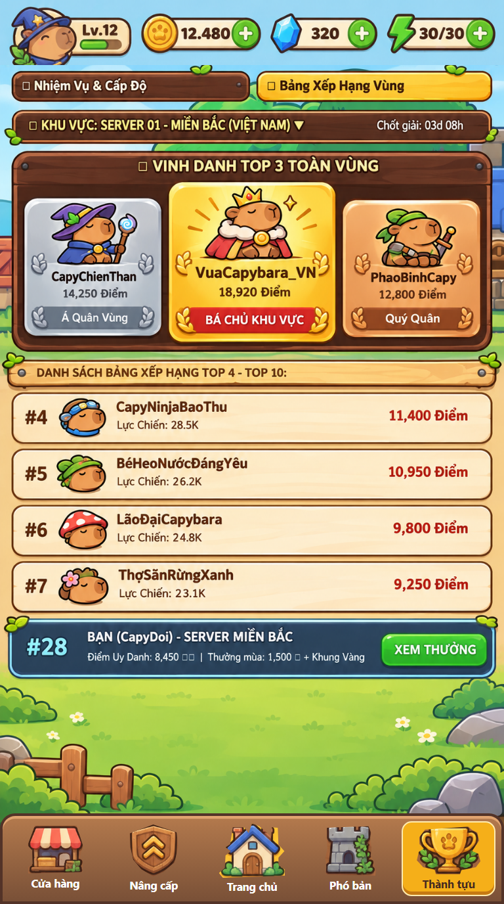 |

**Duyệt bố cục** ☐ Đồng ý ☐ Cần chỉnh

## Prompt tạo ảnh

ImageGen tích hợp nhận hai ảnh cho mỗi cảnh. Ảnh thứ nhất là mẫu bố cục và ảnh thứ hai là mẫu hình ảnh đã duyệt. Prompt giữ tọa độ tương đối, kích thước khối, lưới, thứ tự các vùng và khoảng trống theo ảnh đầu, áp dụng nét bo tròn, giấy da, gỗ và icon từ ảnh sau, cùng các yêu cầu riêng ghi ở từng cảnh.

